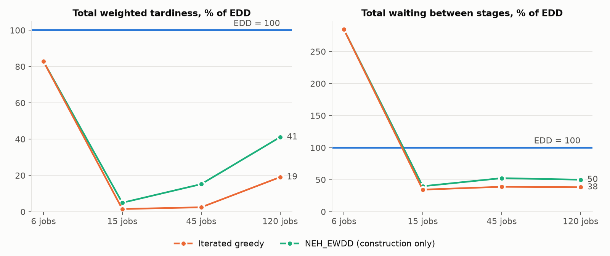
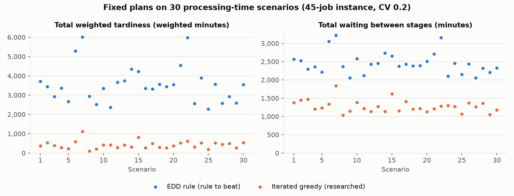
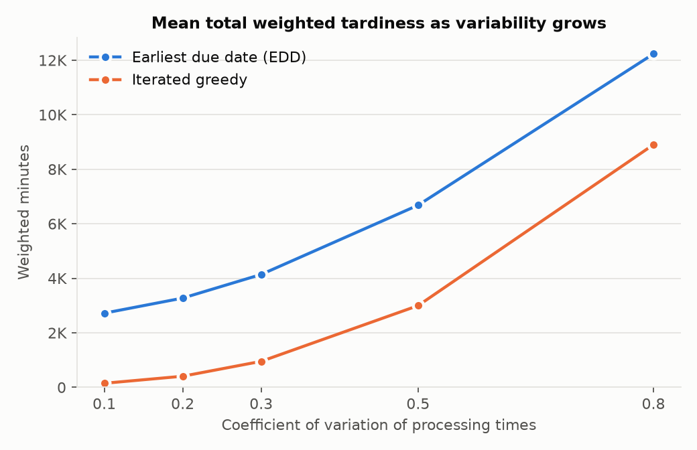

# Option 6: one job sequence for an eight-stage production line

A production planner at a flow line, such as a circuit board assembly line, decides before each planning period the order in which that period's jobs enter the first of eight stages, and because jobs cannot pass one another on the line, that order holds at every stage. Our tool reads the period's job, stage, and processing-time files and returns the order together with the planned start and completion of every operation, chosen to keep total weighted tardiness low. We added three assumptions to the brief. Every stage is free at time zero, so no work carries over from the previous period. The planner fixes the whole sequence before the first job starts and does not revise it when actual times differ, which is the execution rule of the stress test. Among sequences with the same weighted tardiness, the planner prefers the one with less waiting between stages, so the researched method uses waiting to break ties.

## Running the tool

Install [Pixi](https://pixi.sh), then run every command from the repository root. The lock file covers Linux, macOS (Intel and Apple silicon), and Windows.

```bash
pixi install                                                   # build the environment from pixi.lock
pixi run test                                                  # the three required tests and 28 more
pixi run solve data/hand_checkable out/hand                    # researched method, default settings
pixi run solve data/hand_checkable out/rule --method rule      # the rule to beat
pixi run check data/hand_checkable out/hand/decision.json      # independent checker
pixi run reproduce                                             # regenerate every table and plot in results/
```

| Command | What it does | Time on our computer |
| --- | --- | --- |
| `pixi run solve <input_dir> <output_dir>` | Validates the input, runs iterated greedy with its defaults (5000 iterations, seed 522), and writes `decision.json` and `summary.json` | 4.7 s for a 60-job instance |
| `pixi run solve ... --method rule` | The rule to beat. `--method neh` runs NEH_EWDD alone | under 1 s |
| `pixi run check <input_dir> <decision.json>` | Confirms the four constraints and recomputes every measure. `--expect metrics.json` compares the measures with a reference file | under 1 s |
| `pixi run compare` | Deterministic comparison on four instances, written to `results/comparison/` | 5.5 min |
| `pixi run benchmark` | Solves a mixed-integer formulation with HiGHS on the 6-job and 15-job instances, written to `results/benchmark/` | 1.5 min |
| `pixi run stress` | Stress test on the medium instance, written to `results/stress/` | 9 s |
| `pixi run reproduce` | Runs `compare`, `benchmark`, and `stress` | 7 min |
| `pixi run test` | Runs the 31 tests in `tests/` | 9 s |

Relative paths are read from the directory where the command is typed. The output directory must differ from the input directory, and the tool never writes into the input directory. The first run on a new computer compiles the timing kernels with Numba, which adds a few seconds once; later runs reuse the compiled cache.

`solve` responds to the three cases of the instructor's run as follows.

- **Malformed input.** The tool prints every failed check with its file, column, and line, writes nothing, and exits with status 1. For example, the supplied edge case gives `processing_times.csv, column processing_time, line 2: 0 is not positive`.
- **Valid input with no feasible decision.** This cannot occur in option 6, because every sequence of the jobs yields a feasible schedule, but the code path prints `no feasible decision found`, writes no `decision.json`, and exits with status 0.
- **Any other valid input.** The tool writes `decision.json` in the structure of `worked-example/solution.json` (times at full precision) and `summary.json` with the run status, method settings, stopping details, computation time, and measures, and exits with status 0.

## Input checks

The loader in `src/pfsp/data.py` applies the data dictionary's four checks before solving and reports every failure it finds:

1. `jobs.csv`, `stages.csv`, and `processing_times.csv` exist and contain their required columns;
2. every value has its declared type (from the instance's `schema.json` when present, otherwise from the data dictionary) and no required value is empty;
3. every `job_id` and `stage_id` in `processing_times.csv` exists in `jobs.csv` and `stages.csv`; and
4. every processing time is positive.

It also rejects repeated identifiers, a missing or repeated job-stage pair, and `sequence` values that do not run from 1 to the number of stages. Identifiers are matched by value, so reordered rows and renamed identifiers give the same decision, which `tests/test_inputs.py` checks. Missing or invalid values are never replaced.

## Method 1: the rule to beat

The earliest due date rule, implemented exactly as the brief states it in `src/pfsp/rule.py`: sort the jobs by due date, break ties by job identifier, and use that order at every stage.

- **Representation.** A permutation of the jobs. `src/pfsp/timing.py` turns any permutation into a schedule by starting each operation at the later of the job's completion at the previous stage (or its release, at the first stage) and the stage's completion of the previous job.
- **Construction, improvement, stopping.** One sort, no improvement step, no randomness.
- **Limitations.** It ignores weights, release times, and processing times. A job due early but slow at a later stage blocks the jobs behind it, and the rule cannot see that.

On the hand-checkable case the rule reproduces `worked-example/solution.json` exactly, with total weighted tardiness 281 and waiting 13 (test 1).

## Method 2: iterated greedy (researched method)

`src/pfsp/ig.py` implements IG_RS_LS, the iterated greedy algorithm with local search that Ruiz and Stützle (2008) proposed for flow shops with the total weighted tardiness objective, adapted from their makespan version (Ruiz and Stützle, 2007). It calls no solver.

**Why it fits this decision.** Option 6 is a permutation flow shop with release times and weighted tardiness. The rule ranks jobs by due date alone, while every step of iterated greedy compares candidate sequences by their actual weighted tardiness on all eight stages, so it accounts for weights, release times, and jobs that block later stages. Ruiz and Stützle (2008) report that their weighted due date start (NEH_EWDD) beat plain NEH on 470 of 480 test instances and that IG_RS_LS had the lowest average deviation from the best known solutions among the methods they tested for weighted tardiness. In the review of 40 methods for total tardiness by Vallada, Ruiz, and Minella (2008), heuristics built on job insertion and interchange performed best, and the EDD dispatching rule ranked below the NEH variant that starts from EDD order. Neither source includes release times, which this option adds; the timing in `timing.py` handles them in every evaluation.

**Representation.** A permutation of all jobs, timed as for the rule. Sequences are compared on total weighted tardiness first and total waiting between stages second.

**Steps.**

1. *Initialization (NEH_EWDD).* Order the jobs by ascending $d_j / w_j$, ties by job identifier, and insert them one at a time, each at the position of the partial sequence with the best objective. We start from this sequence or from the rule's EDD sequence, whichever is better, so the method can never return a sequence worse than the rule. On all four supplied instances NEH_EWDD was the better start.
2. *Local search.* Take the jobs in random order without repetition, remove each one, and reinsert it at its best position, keeping the move only when it strictly improves the objective. Repeat passes until a pass finds no improvement.
3. *Destruction and construction.* Remove $d = 4$ jobs chosen at random, then reinsert them one by one at their best positions, in the order removed, and apply the local search.
4. *Acceptance.* Accept the new sequence if it is better than the current one. Otherwise accept it with probability $\exp(-\Delta / \text{Temperature})$, where $\Delta$ is the increase in weighted tardiness and $\text{Temperature} = T \cdot \sum_{j,k} p_{jk} / (10 \, n \, m)$ with $T = 0.5$. Keep the best sequence found.

The values $d = 4$ and $T = 0.5$ are the settings of Ruiz and Stützle (2008), who based them on the parameter experiments in Ruiz and Stützle (2007). The insertion search in `best_insertion` times the jobs ahead of each insertion point once and abandons a candidate position as soon as its running totals exceed the best position found, which is valid because both totals only grow as jobs are added. `tests/test_checker.py` confirms the result against brute force.

**Stopping rule.** 5000 iterations of steps 3 and 4. A 300 s time cap is only a safety limit, and no supplied instance reached it; if it ever stops a run, `summary.json` says so.

**Randomization and seed.** NumPy's `default_rng` with seed 522 drives the destruction, the local search order, and the acceptance draws. The same seed reproduces the same sequence (`tests/test_ig.py`). `pixi run solve ... --seed S --iterations N` changes them.

**Departures from the source.** The waiting tie-break, the start from the better of NEH_EWDD and EDD, and the iteration-count stopping rule are ours. The source stops on a CPU-time limit, which would not reproduce across computers.

**Known limitations.** Optimality is certified only on the two smallest instances: enumerating all 720 sequences of the six-job case and solving a mixed-integer formulation with HiGHS on both the six-job and 15-job cases prove the method's answers (233 and 21) optimal. On the 120-job instance 5000 iterations have not converged: five other seeds found sequences with weighted tardiness from 4,159 to 4,306, against 4,383 for the default seed. Each local search pass costs on the order of $n^3 m$ operations, so run time grows quickly with the number of jobs (0.5 s at 15 jobs, 37 s at 120). Waiting enters only as a tie-break, so the method will accept more waiting for any reduction in weighted tardiness; on the six-job case it accepts 37 minutes of waiting where the rule has 13.

NEH_EWDD alone (`--method neh`) appears in the comparison as a construction-only reference. It is step 1 of the researched method, not a separate method.

## Independent checker

`src/pfsp_check/check.py` reads only the instance CSVs and an exported `decision.json`, uses only the Python standard library, and imports nothing from the solver, so an error in the solver's timing cannot reappear in the check. It reports each job and stage that violates a constraint:

- every job appears once in the sequence and every job-stage pair once in the schedule;
- each duration equals the processing time within $10^{-8}$, so no operation is interrupted;
- each job starts the first stage no earlier than its release and each later stage no earlier than its completion at the previous stage;
- each stage runs one job at a time; and
- the jobs pass through every stage in the order of the sequence.

It then recomputes makespan, total weighted tardiness, on-time fraction, total waiting, and idle time by stage from the reported starts and completions. An operation that starts later than the sequence requires is feasible and is reported as a note. `tests/test_checker.py` damages the worked example in each of these ways and confirms the checker reports it.

## Tests

`pixi run test` runs 31 tests. The three the guide requires are in `tests/test_required.py`:

1. the rule reproduces the worked example's decision and every measure in `metrics.json`;
2. the supplied edge case is rejected with a message naming `processing_times.csv` and `processing_time`, no `decision.json`, and a nonzero exit status; and
3. a copy of `development_small` whose `jobs.csv` lacks the `due_date` column is rejected with `jobs.csv, column due_date: required column is missing`.

The other tests cover each input check, reordered rows, renamed identifiers, every kind of violation the checker reports, the insertion search against brute force, and the researched method (checker-confirmed decisions that beat the rule by more than 0.001 on all four instances, reproducibility under one seed, and the enumerated optimum on the six-job case) and the mixed-integer benchmark, which must prove the same optimum.

## Deterministic comparison

`pixi run compare` gives both methods the same files. The checker confirms every decision and supplies every measure. Computer: Intel Core Ultra 7 155U laptop, Linux under WSL2, Python 3.12. The rule has no time limit; iterated greedy stops after 5000 iterations with a 300 s safety cap that no run reached. Times are in minutes and tardiness in weighted minutes. The full table, with makespan and on-time fraction, is in [results/comparison/comparison.md](results/comparison/comparison.md).

| Instance | Jobs | Rule TWT | Iterated greedy TWT | Rule waiting | Iterated greedy waiting | Rule seconds | Iterated greedy seconds |
| --- | ---: | ---: | ---: | ---: | ---: | ---: | ---: |
| hand_checkable | 6 | 281 | 233 | 13 | 37 | 0.000 | 0.21 |
| development_small | 15 | 1,417 | 21 | 732 | 252 | 0.000 | 0.52 |
| development_medium | 45 | 2,371 | 58 | 2,040 | 794 | 0.000 | 3.2 |
| development_large | 120 | 23,015 | 4,383 | 7,863 | 3,005 | 0.000 | 37.2 |



Every decision of both methods is feasible. `pixi run benchmark` solves a positional mixed-integer formulation with HiGHS (one thread, zero gap tolerance, 600 s limit) and proves the optimal weighted tardiness: 233 on the six-job case in 0.4 s and 21 on the 15-job case in 85.8 s, both equal to the researched method's results; on the 15-job case the solver's optimal order has 323 minutes of waiting where iterated greedy's has 252 ([results/benchmark/benchmark.md](results/benchmark/benchmark.md)). On the six-job case the researched method lowers weighted tardiness by 17 percent and reaches the enumerated optimum, but it has nearly three times the rule's waiting. On the 15-job and 45-job instances it removes 98 percent of the rule's weighted tardiness and 61 to 66 percent of its waiting. On the 120-job instance it removes 81 percent of the weighted tardiness, the smallest share among the development instances, and the other seeds listed under the method's known limitations show that more search lowers it further. The run time grows from under a second to 37 s across these sizes. These are four instances from one generator, and the held-out instance may behave differently.

## Stress test

The uncertain input is processing time. In each scenario every processing time of `development_medium` is multiplied by an independent lognormal factor with mean 1 and coefficient of variation 0.2. `pixi run stress` draws 30 scenarios from seed 20261103 and saves them in `results/stress/scenarios/` before either method runs, then executes both deterministic plans on the files read back. Each plan keeps its sequence and starts every operation as early as the realized times allow, and the checker confirms each realized schedule against its scenario.

| Method | Planned TWT | Mean TWT | 90th percentile TWT | Planned waiting | Mean waiting | 90th percentile waiting | Scenarios breaking a hard constraint |
| --- | ---: | ---: | ---: | ---: | ---: | ---: | ---: |
| EDD rule | 2,371.0 | 3,541.1 | 4,616.6 | 2,040.0 | 2,454.5 | 2,768.6 | 0 |
| Iterated greedy | 58.0 | 420.6 | 592.2 | 794.0 | 1,276.9 | 1,454.9 | 0 |



The iterated greedy plan has the lower weighted tardiness in all 30 scenarios. Both plans lose ground to variability: the iterated greedy plan's mean weighted tardiness rises from the planned 58 to 421 and the rule's from 2,371 to 3,541. The iterated greedy plan has 4 late jobs as planned and 11.5 on average across the scenarios, while the rule's plan has 34 and 36.1. The iterated greedy plan's on-time jobs do not have thinner margins (median slack 31 minutes against the rule's 28); it loses more because it has more on-time jobs at stake, 41 against 11. No scenario breaks a hard constraint for either plan. Under the execution rule every operation still follows release, stage order, and one job per stage, and the brief's due dates are soft targets.

We repeated the execution at other coefficients of variation, 30 scenarios each, to find where the comparison changes (`results/stress/stress.md`):

| Coefficient of variation | Rule mean TWT | Iterated greedy mean TWT | Iterated greedy 90th percentile | Scenarios where iterated greedy is better |
| ---: | ---: | ---: | ---: | ---: |
| 0.1 | 2,720.1 | 148.1 | 228.4 | 30 of 30 |
| 0.2 | 3,273.5 | 407.2 | 643.9 | 30 of 30 |
| 0.3 | 4,139.8 | 952.5 | 1,676.0 | 30 of 30 |
| 0.5 | 6,680.4 | 2,996.7 | 5,434.2 | 30 of 30 |
| 0.8 | 12,230.5 | 8,901.6 | 14,219.8 | 29 of 30 |



## Recommendation

We recommend sequencing the line with iterated greedy. On the 45-job instance, with processing times varying at a coefficient of variation of 0.2, its fixed plan averages 3,121 fewer weighted minutes of tardiness per planning period than the earliest due date plan (420.6 against 3,541.1, with a 90th percentile of 592.2 against 4,616.6), and it halves the waiting between stages (1,276.9 against 2,454.5 minutes). The tradeoff we accept is a plan the planner cannot trace by hand, which depends on a seed and takes seconds to compute (3 s for 45 jobs, 37 s for 120) where the rule takes a sort; on very small batches it can also add waiting, as on the six-job case (37 minutes against 13). The recommendation would change if processing times varied much more than we tested: the plan's advantage in mean weighted tardiness falls from 88 percent of the rule's value at a coefficient of variation of 0.2 to 27 percent at 0.8, where the rule's plan was better in 1 of 30 scenarios and the iterated greedy plan's 90th percentile (14,220) exceeded the rule's mean (12,231).

## Tools and attribution

We built the tool with Claude Code (Anthropic, model Claude Opus 5.5), which drafted the code, tests, and documentation under our direction. Every number reported here comes from `pixi run reproduce`, and the independent checker confirmed every decision behind it. The papers were retrieved through the University of Alabama library; `library/LEDGER.md` records each fetch and what each reading established. The data in `data/` are the instructor's synthetic option 6 package for OM 522, Fall 2026, copied unchanged. No code from the in-class notebooks is used. Python packages: NumPy, Numba, Matplotlib, HiGHS (highspy), and pytest from conda-forge. HiGHS appears only in the labeled benchmark, never in either method.

## Repository layout

| Path | Contents |
| --- | --- |
| `src/pfsp/` | The tool: `data.py` (loader and input checks), `timing.py` (schedule timing kernels), `rule.py` (method 1), `ig.py` (method 2), `output.py` (decision and summary files), `cli.py` (commands), `compare.py`, `mip.py` and `benchmark.py` (mixed-integer benchmark), `stress.py`, `figures.py` |
| `src/pfsp_check/` | The independent checker |
| `tests/` | The 31 tests |
| `data/` | The supplied instances, worked example, data dictionary, and brief |
| `results/comparison/` | Comparison tables, plot, settings, and every compared decision |
| `results/benchmark/` | Mixed-integer benchmark table, settings, and the solver's decisions |
| `results/stress/` | Saved scenarios, both plans, per-scenario results, summary, and plots |
| `library/` | Ledger and index of the papers read (the PDFs are not redistributed) |
| `docs/` | Outline of the prototype video |
| `slides/` | Beamer slides for the prototype video (`Option6_Prototype_Slides.tex` and its PDF) |

## References

- Ruiz, R., and Stützle, T. (2007). A simple and effective iterated greedy algorithm for the permutation flowshop scheduling problem. *European Journal of Operational Research*, 177(3), 2033-2049. https://doi.org/10.1016/j.ejor.2005.12.009
- Ruiz, R., and Stützle, T. (2008). An Iterated Greedy heuristic for the sequence dependent setup times flowshop problem with makespan and weighted tardiness objectives. *European Journal of Operational Research*, 187(3), 1143-1159. https://doi.org/10.1016/j.ejor.2006.07.029
- Vallada, E., Ruiz, R., and Minella, G. (2008). Minimising total tardiness in the m-machine flowshop problem: A review and evaluation of heuristics and metaheuristics. *Computers & Operations Research*, 35(4), 1350-1373. https://doi.org/10.1016/j.cor.2006.08.016

The NEH insertion heuristic of Nawaz, Enscore, and Ham (1983, *Omega*) underlies steps 1 and 3. We could not obtain that paper through the library, so we take its steps from Section 3 of Ruiz and Stützle (2007).
